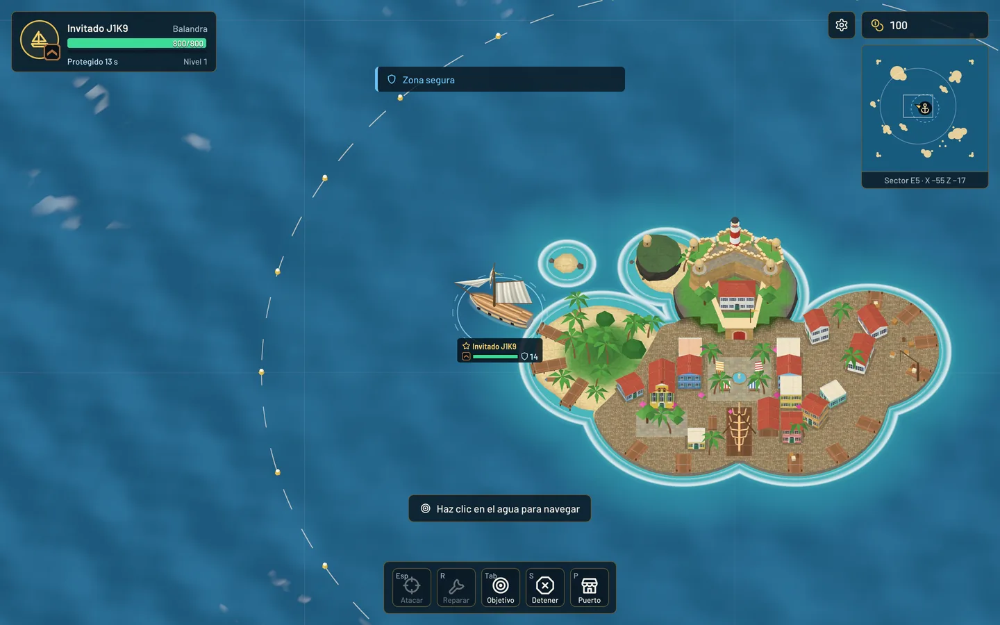

# Sea Battle

Batallas navales multijugador en el navegador, inspiradas en Seafight: navega con un clic, hunde piratas y mercantes con ataques persistentes y mejora tu barco con el botín.

**[Juega en seabattle.jonattan.dev](https://seabattle.jonattan.dev)**, en el navegador y sin instalar nada. Para entrar hace falta crear una cuenta.



## Para jugar

### Cómo se juega

- **Navegar:** haz clic (o toca) en el agua. Tu barco va solo hasta allí y esquiva las islas. `S` lo detiene.
- **Atacar:** selecciona un barco con un clic (o con `Tab`) y pulsa `Espacio` o **Atacar**. Tus cañones disparan solos mientras esté a tiro.
- **Reparar:** `R` o **Reparar**. El barco se para y recupera vida, gratis.
- **Puerto:** dentro de la zona segura, `P` o **Puerto** abre el astillero, donde compras mejoras y barcos con el oro del botín.
- **Cámara:** sigue a tu barco. En **Opciones** puedes elegir la cámara **Libre**, y con **Centrar** (`C`) vuelves al barco. La rueda del ratón o el pellizco acercan y alejan la vista.
- **Niveles:** hundir barcos da experiencia. Hay 20 niveles y 5 insignias.

Todo lo demás está en la [guía del jugador](docs/GUIA-DEL-JUGADOR.md).

### Qué hay nuevo y qué viene

- **Versión actual: 1.2.0.** Un mapa nuevo con 8 islas, 4 calas piratas, un paso entre escollos y un puerto con forma de isla, y el Capitán pirata y las cañoneras como parte fija del juego. El detalle de cada versión está en el [CHANGELOG](CHANGELOG.md).
- **Lo que viene**, en lenguaje llano y sin fechas, está en la [hoja de ruta](ROADMAP.md).
- **Para que vaya fluido**, el navegador tiene que usar la tarjeta gráfica (la «aceleración por hardware», que suele venir activada). Sin ella, el mapa nuevo va muy lento.

---

## Para desarrolladores

### Puesta en marcha

1. Clona el repositorio:
   ```bash
   git clone https://github.com/jonattan-infante/sea-battle.git
   cd sea-battle
   ```
2. Usa Node 24 (el de Railway; lo fijan `.nvmrc` y `engines` en `package.json`) e instala las dependencias:
   ```bash
   nvm use
   npm install
   ```
3. Copia las variables de entorno y pon tus claves de [Clerk](https://dashboard.clerk.com/) en `.env.local`:
   ```bash
   cp .env.example .env.local
   ```
4. Arranca el servidor de desarrollo y abre [http://localhost:3000](http://localhost:3000):
   ```bash
   npm run dev          # con Clerk
   npm run dev:guest    # modo invitado local (AUTH_BYPASS=1), sin cuenta
   ```

### Scripts

| Script | Qué hace |
|---|---|
| `npm run dev` / `npm run dev:guest` | Servidor de desarrollo, con Clerk o en modo invitado local |
| `npm run build` / `npm start` | Build de producción (Next.js + servidor en `dist/`) y su arranque |
| `npm run typecheck` | TypeScript estricto: cliente, servidor y tests |
| `npm test` | Jest: simulación por criterio de aceptación, protocolo y servidor con sockets reales |
| `npm run test:map11` | Jest: la economía del mapa 1.1 con 20 semillas |
| `npm run test:e2e` | Playwright: jugabilidad y multijugador sobre el build de pruebas |
| `npm run test:perf` | Rendimiento: commits de React, mensajes de red y draw calls |
| `npm run test:soak` | 10 minutos de juego sin fugas de memoria, DOM ni geometrías (`AC91_MINUTES=2` para el modo corto) |
| `npm run test:stress` | Servidor lleno con bots, en local |
| `npm run qa:capture` | Capturas de escritorio y móvil en `qa-artifacts/` |
| `npm run verify` | typecheck + test + scripts + build: la puerta de la CI |

### Arquitectura

- Servidor autoritativo (Socket.IO) con una simulación pura y determinista en `src/game/`, a 20 Hz.
- Red por deltas a 10 Hz dentro de un área de interés de 300 m, y sin tráfico cuando nadie actúa.
- Render con React Three Fiber, sin re-renders por frame; el HUD en React a 10 Hz como mucho.
- Autenticación con Clerk; el modo invitado solo existe en local (`AUTH_BYPASS=1`).

La documentación del juego está en `docs/game/`: `GDD.md` y `BACKLOG.md` (producto), `ART-DIRECTION.md`, `ASSET-SPEC.md` y `VFX-SPEC.md` (diseño) y `TECH-ARCHITECTURE.md` (desarrollo). El equipo de agentes (producto, diseño, desarrollo y QA) está definido en `CLAUDE.md` y `.claude/agents/`.

### Despliegue

Corre en Railway, con un servidor Node propio. Cómo se despliega este proyecto y cómo montar el tuyo: [docs/DEPLOY.md](docs/DEPLOY.md).

### Tecnologías

- [Next.js](https://nextjs.org/): framework React
- [Socket.IO](https://socket.io/): WebSockets en tiempo real
- [Three.js](https://threejs.org/) con [React Three Fiber](https://r3f.docs.pmnd.rs/): render 3D
- [Clerk](https://clerk.com/): autenticación
- [Tailwind CSS](https://tailwindcss.com/): estilos
- [Zustand](https://zustand-demo.pmnd.rs/): gestión de estado

## Licencia

[MIT](LICENSE).
